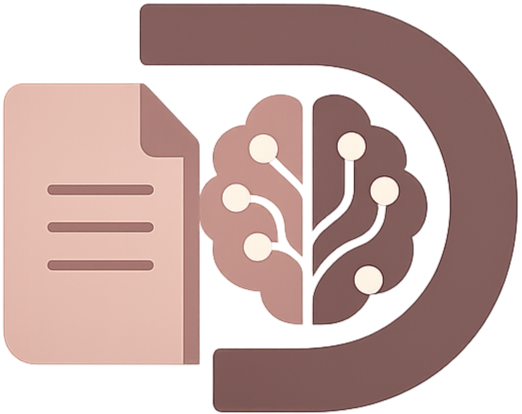
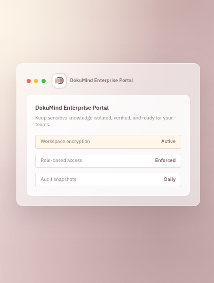
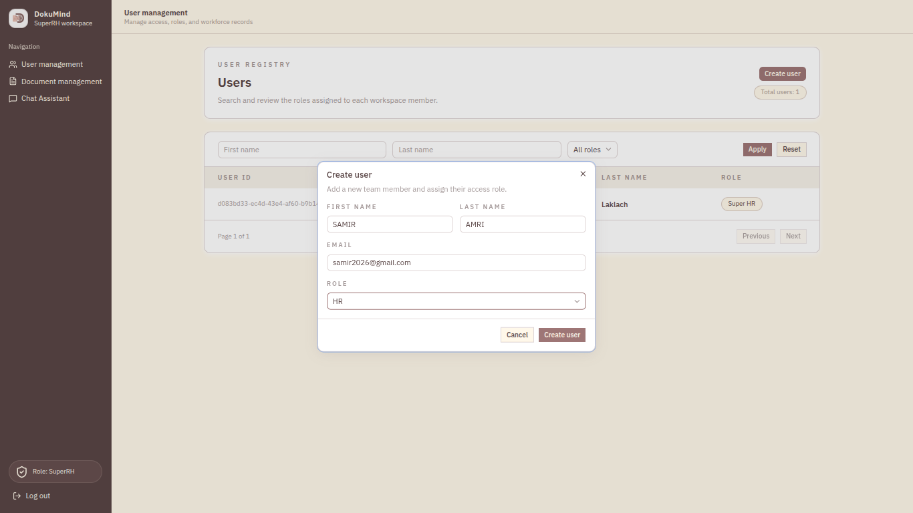
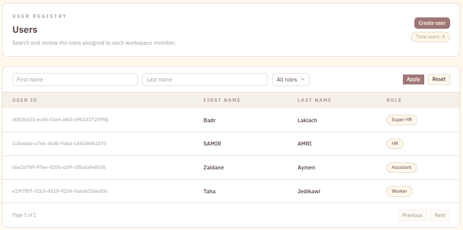
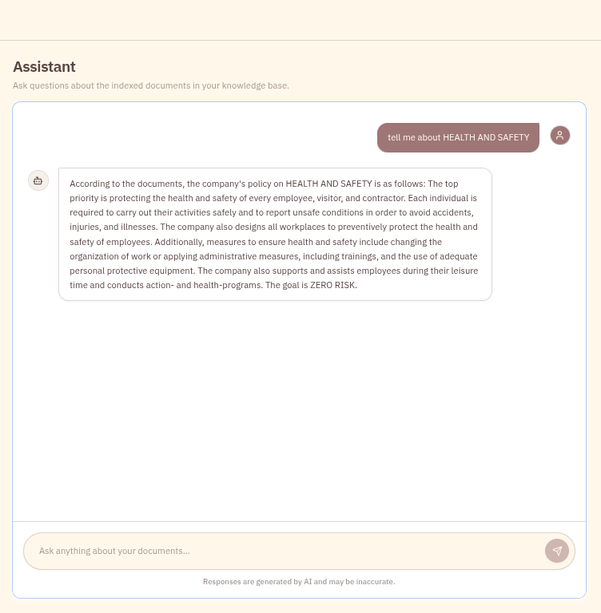
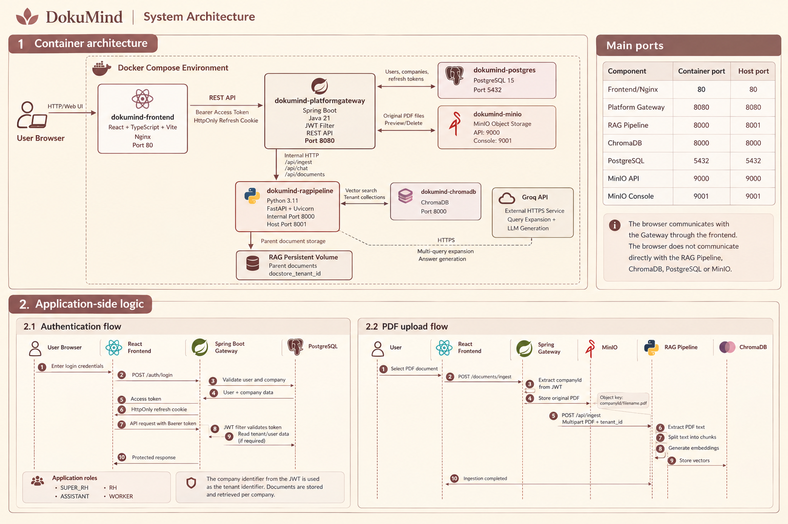
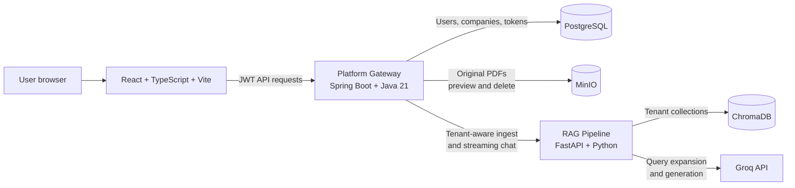
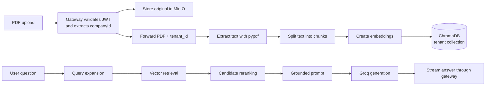

# DokuMind

<p align="center">
  
</p>

<h1 align="center">Enterprise intelligent knowledge management</h1>

<p align="center">
  A multi-tenant SaaS platform for securely storing company documents, indexing their content, and asking grounded questions over private knowledge bases.
</p>

<p align="center">
  
</p>

> DokuMind was developed as a semester-long full-stack project to explore how authentication, tenant isolation, document management, semantic retrieval, and generative AI can work together in an enterprise workflow.

## Contents

- [Product tour](#product-tour)
- [What DokuMind does](#what-dokumind-does)
- [Architecture](#architecture)
- [Service map](#service-map)
- [Quick start with Docker](#quick-start-with-docker)
- [Configuration](#configuration)
- [API surface](#api-surface)
- [Manual development](#manual-development)
- [Verification and observability](#verification-and-observability)
- [Repository layout](#repository-layout)
- [Security notes](#security-notes)
- [Credits](#credits)

## Product tour

The included screenshots show the main product surfaces: role-based administration, user provisioning, and knowledge-grounded chat.

<table>
  <tr>
    <td width="50%" align="center">
      
      <br />
      <sub>Provision a workspace member and assign an access role.</sub>
    </td>
    <td width="50%" align="center">
      
      <br />
      <sub>Filter and review users within the active company.</sub>
    </td>
  </tr>
  <tr>
    <td width="50%" align="center">
      
      <br />
      <sub>Ask questions and receive a streamed, document-grounded answer.</sub>
    </td>
    <td width="50%" align="center">
      
      <br />
      <sub>See the container topology and authentication/upload flows.</sub>
    </td>
  </tr>
</table>

## What DokuMind does

- **Secure document workspace** — upload PDF files, keep originals in MinIO, preview them, list them, and delete them.
- **Tenant-aware knowledge bases** — the active company is resolved from the JWT; documents and vector collections are kept company-scoped.
- **Role-based access** — dedicated portals for SUPER_RH, RH, ASSISTANT, and WORKER roles.
- **Grounded retrieval** — extract PDF text, split it into chunks, create embeddings, search ChromaDB, rerank candidates, and build an answer from retrieved context.
- **Query expansion** — generate multiple search formulations before retrieval to improve recall for natural-language questions.
- **Hallucination fallback** — return a safe fallback when relevant chunks do not pass the similarity gate.
- **Streaming chat** — stream generated text from the RAG service through the gateway to the browser.
- **Operational administration** — create, update, inspect, reset, filter, paginate, and delete users within the active company.

## Architecture

The browser communicates with the Spring Boot gateway through the React application. It does not connect directly to PostgreSQL, MinIO, ChromaDB, or the RAG service.



The detailed container and request-flow diagram is also available as an image:

<p align="center">
  
</p>

### Document and chat lifecycle



## Service map

| Component | Responsibility | Local endpoint |
| --- | --- | --- |
| FrontEnd | React SPA, authentication flows, role-based portals, document UI, and chat UI | http://localhost in Docker; http://localhost:5173 with Vite |
| PlatformGateway | JWT login/signup/refresh/logout, tenant resolution, user administration, MinIO storage, and RAG proxying | http://localhost:8080 |
| RAGPipeline | PDF ingestion, chunking, embeddings, retrieval, reranking, grounded generation, and streaming | http://localhost:8001 from the host; port 8000 inside Compose |
| PostgreSQL | Companies, users, and refresh-token persistence | localhost:5432 |
| MinIO | Original PDF object storage and preview source | API localhost:9000; console localhost:9001 |
| ChromaDB | Tenant-scoped vector collections | localhost:8000 |
| Groq | External model service used for query expansion and answer generation | Configured with GROQ_API_KEY |

### Role model

| Role | Portal | Main capabilities |
| --- | --- | --- |
| SUPER_RH | /admin | Manage company users, documents, and grounded chat |
| RH | /rh | Manage company users, documents, and grounded chat |
| ASSISTANT | /assistant | Manage documents and ask questions over the company knowledge base |
| WORKER | /worker | Ask questions over the company knowledge base |

The initial signup creates the company and its first SUPER_RH user. Additional users are created from the administration surfaces.

## Quick start with Docker

Docker Compose is the recommended way to run the complete stack.

### 1. Prepare the local Compose file

The repository tracks docker-compose.example.yml; the working docker-compose.yml is intentionally ignored because it contains local configuration.

```bash
git clone https://github.com/BadrLaklach/DokuMind.git
cd DokuMind
cp docker-compose.example.yml docker-compose.yml
```

On PowerShell, use:

```powershell
Copy-Item docker-compose.example.yml docker-compose.yml
```

Edit the generated docker-compose.yml and replace every placeholder, especially:

- YOUR_POSTGRES_PASSWORD
- YOUR_MINIO_ROOT_PASSWORD
- YOUR_GROQ_API_KEY
- YOUR_GROQ_MODEL (for example, llama-3.1-8b-instant)
- access-token and refresh-token secrets
- SMTP username and password if email-based credentials or password resets are used

### 2. Build and start the services

```bash
docker compose up --build
```

To run in the background:

```bash
docker compose up --build -d
```

### 3. Open the local services

| Service | URL |
| --- | --- |
| DokuMind web application | [http://localhost](http://localhost) |
| Platform Gateway | [http://localhost:8080](http://localhost:8080) |
| RAG API documentation | [http://localhost:8001/docs](http://localhost:8001/docs) |
| RAG health endpoint | [http://localhost:8001/health](http://localhost:8001/health) |
| MinIO console | [http://localhost:9001](http://localhost:9001) |
| ChromaDB | [http://localhost:8000](http://localhost:8000) |

### 4. Try the first end-to-end flow

1. Open the web application and create the first company account.
2. Sign in as the generated SUPER_RH user.
3. Upload a text-based PDF from the document-management page.
4. Wait for ingestion to finish and confirm the document appears in the workspace.
5. Open the assistant and ask a question that can be answered from the PDF.
6. Use the user-management page to create another company member and confirm the role appears in the user registry.

## Configuration

### Docker Compose configuration

The generated local docker-compose.yml provides the runtime configuration for the full stack:

| Setting | Used by | Purpose |
| --- | --- | --- |
| POSTGRES_PASSWORD | PostgreSQL and gateway | Database credentials |
| MINIO_ROOT_PASSWORD | MinIO and gateway | Object-store credentials |
| GROQ_API_KEY | RAG pipeline | Access to the Groq model API |
| GROQ_MODEL | RAG pipeline | Model used for expansion and generation |
| APPLICATION_SECRET_ACCESS_TOKEN | Gateway | Signs short-lived access tokens |
| APPLICATION_SECRET_REFRESH_TOKEN | Gateway | Signs refresh tokens |
| SPRING_MAIL_USERNAME / SPRING_MAIL_PASSWORD | Gateway | Sends welcome and reset-password emails |

Never commit the local Compose file, credentials, API keys, or runtime data. They are ignored by the repository configuration.

### Service-level configuration

- **Gateway:** copy PlatformGateway/src/main/resources/application.properties.example to application.properties for a manual run. The local properties file is ignored.
- **RAG pipeline:** configure GROQ_API_KEY, GROQ_MODEL, CHROMA_HOST, and CHROMA_PORT in RAGPipeline/.env when running outside Compose.
- **Frontend:** configure VITE_API_URL in FrontEnd/.env; the usual local value is http://localhost:8080.

## API surface

The browser-facing API is exposed by PlatformGateway.

### Authentication

| Method | Endpoint | Description |
| --- | --- | --- |
| POST | /auth/signup | Creates a company and its first SUPER_RH user |
| POST | /auth/login | Authenticates a user and returns an access token |
| GET | /auth/refresh | Issues a new access token from the refresh cookie |
| POST | /auth/logout | Clears the refresh cookie |

### Documents

| Method | Endpoint | Description |
| --- | --- | --- |
| POST | /documents/ingest | Stores a PDF in MinIO and sends it to the RAG pipeline |
| GET | /documents | Lists indexed documents for the active company |
| GET | /documents/preview/{filename} | Streams a PDF preview from MinIO |
| DELETE | /documents?filename=... | Deletes the original and its indexed chunks |
| POST | /documents/chat | Streams a grounded chat response |

### Users

| Method | Endpoint | Description |
| --- | --- | --- |
| GET | /users | Paginated, filterable company user list |
| GET | /users/{userId} | Fetches a user profile |
| POST | /users | Creates an RH, ASSISTANT, or WORKER user |
| PUT | /users/{userId} | Updates user information or role |
| POST | /users/{userId}/reset | Sends a reset-password flow |
| DELETE | /users/{userId} | Removes a company user |

The RAG service also exposes an internal FastAPI API under /api. Direct RAG calls require a validated tenant_id; normal browser requests do not provide it because the gateway derives it from the authenticated company claim.

| Method | Endpoint | Description |
| --- | --- | --- |
| POST | /api/ingest | Ingests a PDF for a tenant |
| POST | /api/chat | Streams a tenant-scoped answer |
| GET | /api/documents?tenant_id=... | Lists indexed documents |
| DELETE | /api/documents?filename=...&tenant_id=... | Removes indexed chunks |
| GET | /health | Checks RAG and ChromaDB availability |

## Manual development

Manual development still requires PostgreSQL, MinIO, ChromaDB, a Groq API key, and the corresponding runtime configuration.

### RAG pipeline

```bash
cd RAGPipeline
python -m venv .venv
source .venv/bin/activate          # Windows: .venv\Scripts\Activate.ps1
pip install -r requirements.txt
uvicorn main:app --host 0.0.0.0 --port 8001 --reload
```

Use CHROMA_HOST=localhost and CHROMA_PORT=8000 when ChromaDB is running locally on its default port. Point the gateway at http://localhost:8001.

### Platform gateway

Create the ignored runtime configuration and start Spring Boot:

```bash
cd PlatformGateway
cp src/main/resources/application.properties.example src/main/resources/application.properties
./mvnw spring-boot:run              # Windows: .\mvnw.cmd spring-boot:run
```

Set rag.pipeline.url=http://localhost:8001 in the local properties file when using the manual RAG port above.

### Frontend

```bash
cd FrontEnd
npm ci
npm run dev
```

The Vite development server runs at http://localhost:5173 and uses VITE_API_URL to reach the gateway.

## Verification and observability

Run the checks that match the part of the stack you changed:

```bash
# Frontend
cd FrontEnd
npm run lint
npm run build

# Gateway
cd ../PlatformGateway
./mvnw test                       # Windows: .\mvnw.cmd test
```

For a running Docker stack:

```bash
docker compose ps
docker compose logs -f platformgateway
docker compose logs -f ragpipeline
```

The RAG health response reports both service status and ChromaDB connectivity. The Swagger UI at /docs makes the internal ingestion, chat, and document endpoints inspectable during development.

## Repository layout

```text
DokuMind/
├── FrontEnd/                         # React + TypeScript + Vite SPA
├── PlatformGateway/                  # Spring Boot REST gateway
├── RAGPipeline/                      # FastAPI ingestion and RAG service
├── Rapport_dockumind/                # Architecture and product screenshots
├── docker-compose.example.yml        # Safe Compose template
├── README.md
└── linked in post.md                 # Project announcement draft
```

## Security notes

The repository is an educational/full-stack project and should be hardened before production use:

- Replace every placeholder secret and use a secret manager in deployed environments.
- Do not expose PostgreSQL, MinIO, or ChromaDB directly to untrusted networks.
- Terminate TLS at the deployment edge and keep refresh tokens in secure, HttpOnly cookies.
- Review CORS, upload limits, logging, and SMTP configuration before exposing the application publicly.
- Replace the example database lifecycle setting (create-drop) with a migration-based strategy before production deployment.

## Credits

DokuMind was developed by **Badr Laklach** and **Ayman Zaidane** as a collaborative semester project under the guidance of **Engineer, PhD Samir Amri**.

The project combines React, TypeScript, Spring Boot, Java 21, FastAPI, Python, PostgreSQL, MinIO, ChromaDB, Groq, and Docker Compose.
